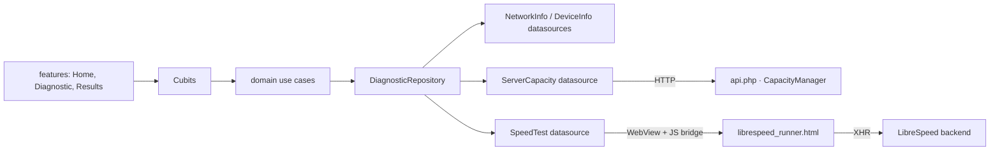

# Architecture

MaxDiagnostic follows **Clean Architecture**: business rules live in `domain` and do not depend on Flutter, packages or the network. `data` implements the contracts declared by `domain`, and `features` only presents state.

## Layers

| Layer | Folder | Responsibility |
|---|---|---|
| Core | `lib/core` | Configuration (`AppConfig`, `EnvironmentConfig`), dependency injection (`get_it`), errors and failures, connectivity check, platform channel for the Wi-Fi link speed, theme and the base `UseCase`. |
| Domain | `lib/domain` | Entities (`NetworkInfoEntity`, `SpeedTestResultEntity`, `FinalResultsEntity`, diagnostic flow events), repository contracts, use cases (`GetInitialNetworkInfo`, `CheckServerReachability`, `RunDiagnosticTest`) and `AdviceService`, which turns results into recommendations. |
| Data | `lib/data` | Datasources for device info, network/Wi-Fi info, server capacity and the speed test, models that map JSON to entities, and `DiagnosticRepositoryImpl`, which orchestrates the test. |
| Presentation | `lib/features` | `home` (initial network snapshot and server reachability), `diagnostic` (progress and queue) and `results` (summary, advice and PDF), each with a Cubit, screens and widgets. |
| App | `lib/app`, `lib/services` | Routes (`go_router`) and the PDF report service. |

Errors cross layers as `Either<Failure, T>` (`dartz`): datasources throw exceptions, the repository converts them into failures, and Cubits only handle failures.

## Diagnostic flow

1. **Home** reads the Wi-Fi and connection details and checks that the speed test server answers.
2. **Reserve a slot.** `DiagnosticRepositoryImpl` calls `reserve_slot` on the server's `api.php`.
   - `GRANTED`: the test starts and the token is kept.
   - `BUSY` (HTTP 429): the repository emits `DiagnosticQueueing` with the estimated wait. `DiagnosticCubit` shows the queue and tries again after that time.
3. **Speed test.** `SpeedTestRemoteDataSource` opens a headless WebView with `librespeed_runner.html`, calls `initialize()` and `startTest()` and listens to the JavaScript bridge (`FlutterChannel`):
   - `progress` events update download, upload and ping in real time;
   - `end` delivers download, upload, ping, jitter and IP information;
   - `error` ends the test with a failure.

   A global timeout (5 minutes) and progress watchdogs abort a test that stops reporting.
4. **Release the slot.** The token is released whether the test finished or failed. If the release never arrives, the server frees the slot after `MAX_TEST_DURATION_SECONDS`.
5. **Results.** A second network snapshot is taken, `AdviceService` produces the recommendations and `ReportService` builds the PDF with the before/after Wi-Fi comparison.

## Speed test server

The server is the official LibreSpeed image plus three files from `docker/librespeed`:

- `librespeed_runner.html`: the page the app loads in the WebView.
- `server/api.php`: the capacity endpoint (`check_capacity`, `reserve_slot`, `release_slot`).
- `server/CapacityManager.php`: keeps the active slots in a JSON file and changes them under an exclusive lock, so concurrent reservations never exceed `MAX_CONCURRENT_TESTS`.

Setup and configuration are in the [Self-Hosting Guide](SELF_HOSTING_GUIDE.md).

## Tests

- **Unit tests** (`test/`) cover the datasources, the repository, the `RunDiagnosticTest` use case and the Cubits, with `bloc_test` and `mocktail`.
- **Server smoke test** (`docker/librespeed/smoke-test.sh`) starts the container and checks the endpoints, the reserve/refuse/release flow and 20 concurrent reservations.
- **CI** runs formatting, analysis, the tests and the release APK build for the app, and the smoke test for the server, on every push and pull request.
